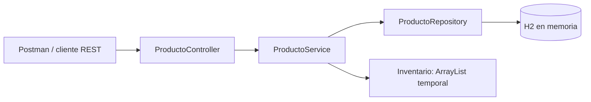
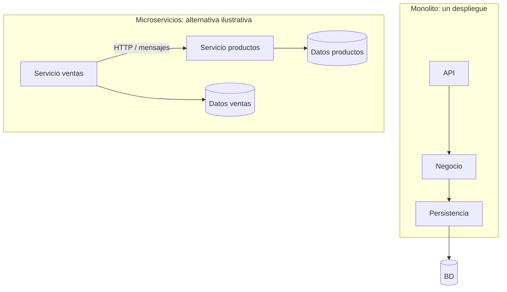
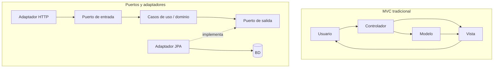

# Arquitectura y comparaciones

El monolito/microservicios describe cómo se despliega y divide un sistema. MVC/hexagonal describe responsabilidades y dependencias internas. Son ejes distintos: un monolito también puede ser hexagonal y un microservicio puede utilizar MVC.

## Implementación entregada

El contenedor Spring configura las dependencias por constructor. El controlador recibe DTO y devuelve datos o ResponseEntity, según la operación. El servicio valida reglas y coordina la transacción. El repositorio persiste las entidades. Inventario recibe una consulta de H2; sus bucles realizan búsqueda y máximo. La respuesta se convierte en ProductoResponse y se serializa a JSON.

## Monolito frente a microservicios

Un monolito simplifica la ejecución y prueba de este CRUD pequeño. Los microservicios permiten despliegue y escalado por capacidad de negocio, a cambio de coordinación de red, fallos parciales y consistencia distribuida. No se añaden servicios de ventas al código: solo ilustran la comparación.

## MVC frente a hexagonal

MVC separa entrada, modelo y presentación. En esta API se utiliza Spring MVC con @RestController y JSON, sin plantillas HTML. Hexagonal organiza un núcleo independiente de las tecnologías externas mediante puertos y adaptadores. No es una comparación de velocidad: ambas pueden convivir; MVC puede formar parte de un adaptador web.

La opción elegida es monolito por capas: suficiente para un alumno, un inventario y una base de datos. Una futura migración hexagonal exigiría interfaces de casos de uso/persistencia propias y separar las anotaciones JPA del dominio.

Fuentes: Lewis y Fowler, https://martinfowler.com/articles/microservices.html ; Cockburn, https://alistair.cockburn.us/hexagonal-architecture ; Spring, https://docs.spring.io/spring-framework/reference/web/webmvc/mvc-controller/ann-methods/responsebody.html . Consultadas 31/10/2026.
